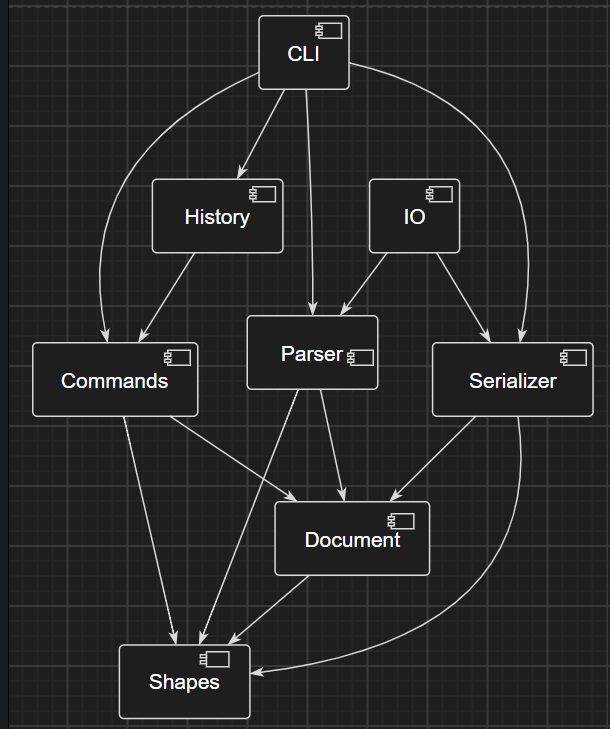

# 2026秋软件设计 Lab1  README文档

24302010001 莫梓铎

github仓库链接：

`https://github.com/HioriYo0301/lab1-svg-editor`

本文档包含第一阶段 SVG CLI 编辑器的架构方案、设计模式落地、开发过程、一致性自查和验收指南

## 1. 架构方案

### 1.1 模块划分

| 模块 | 目录 | 职责 | 
|---|---|---|
| CLI | `src/cli/` | REPL、Tokenizer、命令注册和文本参数解析；将输入转换为应用调用 | 
| Commands | `src/commands/` | 将一次用户编辑封装为 Command；保存执行所需参数并调用领域对象 | 
| Shapes | `src/shapes/` | `Shape` 类层次、六种图形、Group Composite、ShapeFactory 和 SVG 片段序列化 | 
| Document | `src/document/` | 画布尺寸、根节点、全局 id 索引、父子关系和结构不变量 | 
| History | `src/history/` | undo/redo 双栈、IO 历史屏障 | 
| Parser / Serializer | `src/parser/`、`src/serializer/` | SVG XML 读回与输出；读回时补 id 和报告 warning | 
| IO | `src/io/` | 文件系统抽象和 Node 文件实现，便于测试替换 | 

组件关系如下：




### 1.2 设计模式的选择与落地

#### Command

代码中的角色映射如下：

| Command 角色 | 本项目 |
|---|---|
| Command | `src/commands/Command.ts` 的 `execute()` / `undo()` |
| ConcreteCommand | `MoveCommand`、`ScaleCommand`、`SetAttributeCommand`、`DeleteCommand`、`GroupCommand`、`UngroupCommand`、`AddToCommand`、`ZOrderCommand` |
| Receiver | `Shape`、`Group`、`SvgDocument` |
| Invoker / Executor | `History`，负责执行命令并维护 undo/redo 栈 |
| Client | `CliApplication`，解析参数并组装具体命令 |

具体命令中保存了请求参数和撤销所需的状态，业务规则由 Shape、Group、SvgDocument 完成。例如 `MoveCommand` 只调用 `shape.move()`；`DeleteCommand` 保存 `ShapePlacement` 以便恢复父节点和原位置。新编辑会清空 redo 栈。

#### Composite

`Group extends Shape`，因此容器和叶子统一支持 `move`、`scale`、`set`、`delete`、序列化和树形显示。Group 保存有序子节点并递归转发操作；`SvgDocument` 维护全局 id 索引和父子结构不变量。

#### Iterator

`Group implements Iterable<Shape>`。`tree`、文档子树收集、Group 的 SVG 序列化以及递归移动/缩放都通过 `for...of` 或 `[...group]` 访问子图形。内部 `childShapes` 由 Group独享并持续维护。

#### Factory

`ShapeFactory` 集中处理类型名到图形类的创建分派：`rect`、`circle`、`ellipse`、`line`、`text`、`g`。


### 1.3 依赖方向规则

依赖方向固定为：

```text
CLI -> Commands -> Document -> Shapes
CLI -> History
CLI -> Parser / Serializer -> Document / Shapes
IO -> Parser / Serializer
Shapes 不依赖 CLI、Commands、History、Parser、Serializer、IO
```

规则及理由：

1. `shapes` 作为核心，不依赖输入形式和外部资源。
2. `document` 只管理画布和图形树，依赖 `shapes`。
3. `commands` 可以调用 `document` 和 `shapes`，隔离业务规则和命令类。
4. `history` 只依赖 Command 接口，通过栈管理生命周期，与图形操作隔离。
5. `parser`、`serializer` 和 `io` 隔离文件格式与外部文件系统。
6. `cli` 位于最外层，负责错误呈现。

## 2. 变化点假设

| 可能变化 | 当前留出的扩展点 |  
|---|---|
| 新增图形类型 | `Shape` 子类 + `ShapeFactory` 注册点 | 
| 新增 CLI 命令 | `Command` 接口、具体命令类和命令注册表 | 
| undo/redo 策略 | `History` 与 `Command.undo()` | 
| SVG 读写实现 | `SvgReader`、`SvgWriter`、`FileSystem` 接口 | 
| 图形树存储结构 | `Group implements Iterable<Shape>` | 
| GUI/Web 入口 | `CliApplication` 之外的入口层 | 

## 3. 过程记录

### 3.1 分步实现

开发按小步提交完成：初始化工程、Shape 层次、Group Composite、文档模型、CLI 解析、基础命令、编辑命令、结构命令、Command 历史、SVG IO。

### 3.2 发现的代表性问题和修正

- `Shape.parent` 最初为 `Shape | null`，文档结构操作需要 Group 的索引能力，随后定位并修改为 `Group | null`。
- `set` 未知属性最初会先尝试解析数值，导致错误信息不符合规格；定位后调整了分派顺序，现在遇到未知属性会先报告 `unknown attribute`。


## 4. 一致性自查

### 4.1 模块划分

实际目录与方案一致：`cli`、`commands`、`document`、`shapes`、`history`、`parser`、`serializer`、`io` 均已建立。测试放在顶层 `test/`，文档放在 `doc/`，与方案相符。

### 4.2 依赖方向

检查结果：Shape 类不导入 CLI、IO 或 History；Document 只依赖 Shape；Command 依赖 Document/Shape；CLI 负责组装 Parser、Serializer、IO 和 History。没有发现违反既定方向的依赖。

### 4.3 阶段边界

`box` 尚未实现，`create box ...` 仍会报告 unknown shape type，Visitor 尚未实现。

## 5. 验收

### 自动化检查

```powershell
npm run typecheck
npm test
```

测试覆盖：图形几何行为、Group 递归操作、id 唯一性、Tokenizer 引号和注释、基础 CLI、编辑&结构命令、undo/redo、IO 历史屏障、SVG round-trip、缺失 id 自动补全。

## 6. Phase 2 交付说明

+
### 6.1 Required：四个扩展点清单

| 扩展点 | 内核接口与调用位置 | 本阶段实现 | 禁用后的行为 | 契约错误 |
|---|---|---|---|---|
| `ShapeProvider` | `src/plugins/ShapeProvider.ts`；`ShapeFactory.create()`、`fromElement()` | 阶段一图形 provider、`BoxShapeProvider` | 六种阶段一图形仍可用；未装 box 时按普通分组读回 | 重复图形类型或未知类型注册失败 |
| `Command` | `src/plugins/CommandPlugin.ts`；`CliApplication.executeLine()` | 阶段一命令、`StatsCommandPlugin`、`DirCommandPlugin` | 未加载命令返回 `error: unknown command: <name>` | 重复命令名拒绝注册 |
| `TreeDecorator` | `src/plugins/TreeDecorator.ts`；树行渲染流程 | `ModifiedStarDecorator`、`BoxTypeDecorator` | 无 decorator 时使用阶段一原始树输出 | 重复 decorator 名称拒绝注册 |
| `AttributeHandler` | `src/plugins/AttributeHandler.ts`；`SetAttributeCommand` 属性流程 | box 的 `fill`、`label` handler | 未命中时回到阶段一属性白名单 | 冲突注册拒绝，失败修改回滚 |

四个接口定义在内核侧，内核只依赖接口，不按 `box`、`stats` 等具体名称增加分支。插件以类或类实例实现，只依赖公开领域抽象，不依赖宿主装配模块。注册统一经过 `PluginContext` 和 `CliApplication.installExtensions()`。

### 6.2 Required：两种装配方式和配置格式

代码装配由 `src/host/CodeAssembly.ts` 在组合根中实例化插件；配置装配由 `src/host/PluginLoader.ts` 读取仓库根的 `plugins.config.json`。两种方式最终进入同一条暂存注册、冲突检查和原子提交路径。

~~~json
{
  "plugins": [
    { "module": "./plugins/box" },
    { "module": "./plugins/stats" },
    { "module": "./plugins/dir", "options": {} },
    { "module": "./plugins/tree-star", "enabled": false }
  ]
}
~~~

配置按数组顺序加载；`enabled: false` 完全跳过；相对路径以配置文件目录为基准；`options` 传给插件的 `activate`。插件通过 `package.json` 的 `contributes` 声明 `shapes`、`commands`、`decorators`、`attributes`。加载器不硬编码具体插件名称或导入映射。

加载失败统一输出并继续启动：

~~~text
error: plugin not found: <module>
error: plugin has no default export: <module>
error: plugin manifest mismatch: <name> (...)
error: plugin failed to activate: <name> (<reason>)
~~~

失败插件的注册先保存在暂存上下文中；manifest 不一致、重复注册或激活异常时撤销该插件的全部暂存注册，保留此前成功的插件。配置结构错误时输出 `error: invalid plugin config`，回到默认内置能力。

### 6.3 Required：`dir` 的目录访问接口与适配器模式

`src/io/DirectoryAccess.ts` 是 Target，描述读取目录并返回直接子项；Node 的 `fs`/`Dirent` 是 Adaptee；`src/io/NodeDirectoryAccess.ts` 是 Adapter；`DirCommandPlugin` 是 Client。命令只依赖 `DirectoryAccess`，所以测试可以注入内存测试替身，也可以使用临时目录验证真实适配器。

`dir` 保留隐藏项，不递归；目录在前、文件在后、各组名称升序；空目录输出 `(empty directory)`，读取失败输出 `error: cannot read directory: <path>`。它使用 CLI 启动时的工作目录，不依赖 SVG 文档，也不修改文档、dirty 状态和 undo/redo 历史。

### 6.4 Required：A.3 VS Code 职责、模式与复用分析

VS Code 负责扩展生命周期、文档模型、Explorer、Outline、事件分发和结果展示；扩展负责 SVG 判断、轻量解析和结果转换。`extension.activate()` 注册 `FileDecorationProvider` 和 `DocumentSymbolProvider`，之后由 VS Code 分别调用 `provideFileDecoration()` 与 `provideDocumentSymbols()`。

文件标记具有 Decorator 的“附加展示职责”，但不是严格的经典 Decorator：provider 不包装文件对象，而是实现 VS Code 的独立接口并由宿主反向调用。SVG 元素树到 `DocumentSymbol` 的转换属于 Adapter，因为它把内部模型转换为 VS Code 所需模型。阶段一的完整读写解析器面向可编辑领域模型和完整序列化，不能直接复用到需要容忍不完整 XML 的 Outline；本阶段复用了标签/id 约定、树遍历思路和异常输入测试边界。

### 6.5 Required：架构变化、依赖图和 ADR

重构前，命令表、图形工厂和树渲染器直接知道具体能力；重构后，内核只依赖扩展点接口和注册表，新增能力通过插件与组合根接入。依赖方向为：

~~~text
领域模型 / 命令执行器 / 树渲染器
              ↑ 只依赖扩展点接口
插件实现 ----> 公开领域抽象
宿主装配 ----> 插件 + PluginContext
配置加载器 --> 模块解析、manifest 校验、装配
~~~

~~~plantuml
@startuml
[CliApplication] --> [PluginContext]
[ShapeFactory] --> [ShapeProvider]
[TreeRenderer] --> [TreeDecorator]
[CliApplication] --> [Command]
[CliApplication] --> [AttributeHandler]
[stats] ..> [Command]
[dir] ..> [Command]
[box] ..> [ShapeProvider]
[box] ..> [AttributeHandler]
[modified-star] ..> [TreeDecorator]
[(box)] ..> [TreeDecorator]
[CodeAssembly] --> [PluginContext]
[PluginLoader] --> [PluginContext]
@enduml
~~~

ADR 位于 `doc/adr/`，覆盖属性处理器契约与事务、box 读回降级、dirty 语义与祖先传播、配置 manifest 校验和失败回滚。指标脚本为 `scripts/metrics.mjs`，结果位于 `doc/metrics/`；CLI 按内核、装配处、插件三类统计，VS Code 单独统计，依赖和构建产物排除。

### 6.6 Required：阶段性验收、截图和提交历史

每个阶段提交后执行：

~~~powershell
npm run typecheck
npm test
git diff --check
~~~

阶段 6 额外执行 `npm run verify:assembly`。当前本地验收结果为：类型检查通过，13 个测试文件、77 项测试通过；基础、box、stats/dir 三组代码装配与配置装配输出逐字节一致；禁用新增插件时与 `final` 基线逐字节一致。固定输入和预期输出在 [双装配回放](transcript/README.md) 中，完整截图位置见 [lab2实验报告.md](lab2/lab2实验报告.md)。

老师要求用提交历史体现开发过程时，可以在仓库根目录运行：

~~~powershell
git log --date=format:"%Y-%m-%d %H:%M" --pretty=format:"%ad  %h  %s" --reverse --no-decorate final..HEAD
~~~

如果希望把阶段一基线也放入截图：

~~~powershell
git log --date=format:"%Y-%m-%d %H:%M" --pretty=format:"%ad  %h  %d  %s" --reverse -15
~~~

最终创建 `p2` 后，再用下面的命令生成包含标签的历史：

~~~powershell
git log --date=format:"%Y-%m-%d %H:%M" --pretty=format:"%ad  %h  %d  %s" --reverse final..p2
~~~

在 VS Code 终端运行后截取输出即可。建议截图前先拉宽终端窗口，保证日期、短 hash 和 commit 描述在同一行。

当前最新提交仍是阶段 5 的 `de0287a`，`final` 仍指向 `6808a3b`，`p2` 尚未创建。阶段 6 代码、README、报告、测试、配置和截图仍处于未提交状态，因此确实还缺少阶段 6 的关键 commit；最终报告确认无误后，建议提交：

~~~powershell
git add .
git diff --cached --stat
git commit -m "feat: support code and config plugin assembly"
git push origin main
~~~

收尾文档若单独提交，可使用：

~~~powershell
git add doc/README.md doc/lab2 doc/metrics
git commit -m "docs: complete phase 2 report and metrics"
git push origin main
~~~

所有最终验收通过后创建并推送标签：

~~~powershell
git tag p2
git push origin p2
~~~

不要移动已有的 `final` tag。

