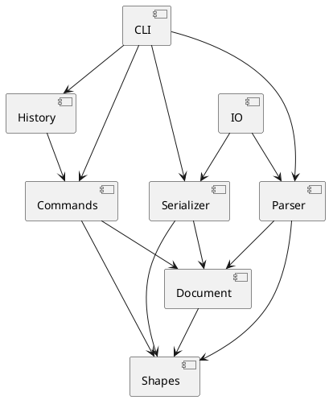

# SVG 编辑器 Lab1 文档

本文件记录第一阶段 SVG CLI 编辑器的架构方案、设计模式落地、开发过程、一致性自查和质量保证依据。实验说明文档是行为规格；课程课件用于指导设计取舍。

## 1. 架构方案

### 1.1 模块划分

| 模块 | 目录 | 职责 | 不负责的事情 |
|---|---|---|---|
| CLI | `src/cli/` | REPL、Tokenizer、命令注册和文本参数解析；将输入转换为应用调用 | 不保存图形业务状态，不直接读写文件 |
| Commands | `src/commands/` | 将一次用户编辑封装为 Command；保存执行所需参数并调用领域对象 | 不实现图形几何规则，不处理终端输入 |
| Shapes | `src/shapes/` | `Shape` 类层次、六种图形、Group Composite、ShapeFactory 和 SVG 片段序列化 | 不依赖 CLI、历史栈或文件系统 |
| Document | `src/document/` | 画布尺寸、根节点、全局 id 索引、父子关系和结构不变量 | 不解析命令文本，不负责文件格式 |
| History | `src/history/` | undo/redo 双栈、IO 历史屏障 | 不直接修改图形 |
| Parser / Serializer | `src/parser/`、`src/serializer/` | SVG XML 读回与输出；读回时补 id 和报告 warning | 不处理 CLI 命令分发 |
| IO | `src/io/` | 文件系统抽象和 Node 文件实现，便于测试替换 | 不解释 SVG 业务语义 |

组件关系如下：



### 1.2 设计模式的选择与落地

#### Command

本 Lab 的硬性要求是 Command。代码中的角色映射如下：

| Command 角色 | 本项目 |
|---|---|
| Command | `src/commands/Command.ts` 的 `execute()` / `undo()` |
| ConcreteCommand | `MoveCommand`、`ScaleCommand`、`SetAttributeCommand`、`DeleteCommand`、`GroupCommand`、`UngroupCommand`、`AddToCommand`、`ZOrderCommand` |
| Receiver | `Shape`、`Group`、`SvgDocument` |
| Invoker / Executor | `History`，负责执行命令并维护 undo/redo 栈 |
| Client | `CliApplication`，解析参数并组装具体命令 |

具体命令保存请求参数和撤销所需的状态，业务规则由 Shape、Group、SvgDocument 完成。例如 `MoveCommand` 只调用 `shape.move()`；`DeleteCommand` 保存 `ShapePlacement` 以便恢复父节点和原位置。新编辑会清空 redo 栈，`init/read/save/canvas` 会建立 IO 历史屏障。

#### Composite

`Group extends Shape`，因此容器和叶子统一支持 `move`、`scale`、`set`、`delete`、序列化和树形显示。Group 保存有序子节点并递归转发操作；`SvgDocument` 维护全局 id 索引和父子结构不变量。

#### Iterator

`Group implements Iterable<Shape>`。`tree`、文档子树收集、Group 的 SVG 序列化以及递归移动/缩放都通过 `for...of` 或 `[...group]` 访问子图形，不依赖调用者知道内部使用数组。内部的 `childShapes` 只由 Group 自己维护。

#### Factory

`ShapeFactory` 集中处理类型名到图形类的创建分派：`rect`、`circle`、`ellipse`、`line`、`text`、`g`。这是实验文档允许的第二处按名字分派点；未注册类型统一报告 unknown shape type。

#### Visitor 的取舍

Visitor 已评估但第一阶段暂缓。当前图形元素类型仍可能增加，且移动、缩放、属性修改和序列化已经由 Shape 多态和 Iterator 完成。引入 Visitor 会让每种新增图形都要求修改所有 Visitor，并增加双分派维护成本。若后续出现多个独立的树分析操作，再重新评估。

### 1.3 依赖方向规则

依赖方向固定为：

```text
CLI -> Commands -> Document -> Shapes
CLI -> History
CLI -> Parser / Serializer -> Document / Shapes
IO -> Parser / Serializer
Shapes 不依赖 CLI、Commands、History、Parser、Serializer、IO
```

规则及理由：

1. `shapes` 是稳定的领域核心，不依赖输入形式和外部资源。
2. `document` 只管理画布和图形树，依赖 `shapes`。
3. `commands` 可以调用 `document` 和 `shapes`，但不能把业务规则复制到命令类。
4. `history` 只依赖 Command 接口，通过栈管理生命周期，不直接操作图形。
5. `parser`、`serializer` 和 `io` 隔离文件格式与外部文件系统。
6. `cli` 位于最外层，负责错误呈现和 REPL，不向领域层泄漏终端细节。

## 2. 变化点假设

| 可能变化 | 当前留出的扩展点 | 当前不扩展的原因 |
|---|---|---|
| 新增图形类型 | `Shape` 子类 + `ShapeFactory` 注册点 | 第一阶段只实现六种内置类型；`box` 留给插件阶段 |
| 新增 CLI 命令 | `Command` 接口、具体命令类和命令注册表 | 命令解析和执行已隔离 |
| undo/redo 策略 | `History` 与 `Command.undo()` | 当前要求是命令级撤销，不采用整文档快照 |
| SVG 读写实现 | `SvgReader`、`SvgWriter`、`FileSystem` 接口 | 便于替换 XML 库或测试文件系统 |
| 图形树存储结构 | `Group implements Iterable<Shape>` | 调用方不依赖 `childShapes` 的具体集合 |
| GUI/Web 入口 | `CliApplication` 之外的入口层 | 本阶段只要求 CLI，不提前增加 UI 依赖 |

## 3. 过程记录

### 3.1 分步实现

开发按小步提交完成：初始化工程、Shape 层次、Group Composite、文档模型、CLI 解析、基础命令、编辑命令、结构命令、Command 历史、SVG IO。每一步都运行 `npm test` 和 `npm run typecheck` 后提交。

### 3.2 代表性修正

- 具体图形类最初错误地从 `Shape.ts` 导入 `ShapeError`，类型检查发现后改为显式从 `ShapeError.ts` 导入。
- `Shape.parent` 最初过宽为 `Shape | null`，文档结构操作需要 Group 的索引能力，随后收窄为 `Group | null`。
- `set` 未知属性最初会先尝试解析数值，导致错误信息不符合规格；调整分派顺序后会先报告 `unknown attribute`。
- SVG 读取初版错误地把第一个子元素当作根内容，round-trip 测试发现后按 `fast-xml-parser` preserve-order 结构修正。
- CLI 增加非交互输入支持，使命令脚本可以通过管道回放，同时保留 `svg>` 交互提示。

## 4. 一致性自查

### 4.1 模块划分

实际目录与方案一致：`cli`、`commands`、`document`、`shapes`、`history`、`parser`、`serializer`、`io` 均已建立。测试放在顶层 `test/`，文档放在 `doc/`，与方案相符。

### 4.2 依赖方向

抽样检查结果：Shape 类不导入 CLI、IO 或 History；Document 只依赖 Shape；Command 依赖 Document/Shape；CLI 负责组装 Parser、Serializer、IO 和 History。没有发现违反既定方向的依赖。

### 4.3 阶段边界

`box` 尚未实现，`create box ...` 仍会报告 unknown shape type，符合第一阶段边界。Visitor 仅记录取舍，没有为了凑模式而加入实现。

## 5. 质量保证手段

### 自动化检查

```powershell
npm run typecheck
npm test
```

测试覆盖：图形几何行为、Group 递归操作、id 唯一性、Tokenizer 引号和注释、基础 CLI、编辑命令、结构命令、undo/redo、IO 历史屏障、SVG round-trip、缺失 id 自动补全和文件失败状态保持。

### 手工检查

1. 使用典型流程图 transcript 回放 `init/create/in/move/undo/redo/save/read/tree`。
2. 在浏览器中直接打开 `save` 生成的 SVG，确认外部格式可渲染。
3. 检查 `git log --oneline --decorate --graph`，确认开发过程是多个语义提交而不是 one-shot 提交。
4. 最终提交前确认 `doc/README.md`、测试、类型检查和工作区状态均完成。

## 6. 当前未完成的交付项

本阶段代码和测试已完成到 SVG CLI 功能闭环；最终交付前仍需完成最终验收、补充可能的格式细节、创建 `final` tag，并将 tag 推送到远程仓库。`box` 插件不属于本阶段交付内容。
