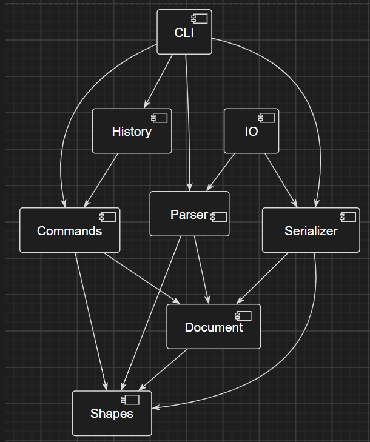

# 2026秋软件设计 Lab1  README文档

24302010001 莫梓铎

本文档包含第一阶段 SVG CLI 编辑器的架构方案、设计模式落地、开发过程、一致性自查和验收指南

## 1. 架构方案

### 1.1 模块划分

| 模块 | 目录 | 职责 | 
|---|---|---|
| CLI | `src/cli/` | REPL、Tokenizer、命令注册和文本参数解析；将输入转换为应用调用 | 
| Commands | `src/commands/` | 将一次用户编辑封装为 Command；保存执行所需参数并调用领域对象 | 
| Shapes | `src/shapes/` | `Shape` 类层次、六种图形、Group Composite、ShapeFactory 和 SVG 片段序列化 | 
| Document | `src/document/` | 画布尺寸、根节点、全局 id 索引、父子关系和结构不变量 | 
| History | `src/history/` | undo/redo 双栈、IO 历史屏障 | 
| Parser / Serializer | `src/parser/`、`src/serializer/` | SVG XML 读回与输出；读回时补 id 和报告 warning | 
| IO | `src/io/` | 文件系统抽象和 Node 文件实现，便于测试替换 | 

组件关系如下：




### 1.2 设计模式的选择与落地

#### Command

代码中的角色映射如下：

| Command 角色 | 本项目 |
|---|---|
| Command | `src/commands/Command.ts` 的 `execute()` / `undo()` |
| ConcreteCommand | `MoveCommand`、`ScaleCommand`、`SetAttributeCommand`、`DeleteCommand`、`GroupCommand`、`UngroupCommand`、`AddToCommand`、`ZOrderCommand` |
| Receiver | `Shape`、`Group`、`SvgDocument` |
| Invoker / Executor | `History`，负责执行命令并维护 undo/redo 栈 |
| Client | `CliApplication`，解析参数并组装具体命令 |

具体命令中保存了请求参数和撤销所需的状态，业务规则由 Shape、Group、SvgDocument 完成。例如 `MoveCommand` 只调用 `shape.move()`；`DeleteCommand` 保存 `ShapePlacement` 以便恢复父节点和原位置。新编辑会清空 redo 栈。

#### Composite

`Group extends Shape`，因此容器和叶子统一支持 `move`、`scale`、`set`、`delete`、序列化和树形显示。Group 保存有序子节点并递归转发操作；`SvgDocument` 维护全局 id 索引和父子结构不变量。

#### Iterator

`Group implements Iterable<Shape>`。`tree`、文档子树收集、Group 的 SVG 序列化以及递归移动/缩放都通过 `for...of` 或 `[...group]` 访问子图形。内部 `childShapes` 由 Group独享并持续维护。

#### Factory

`ShapeFactory` 集中处理类型名到图形类的创建分派：`rect`、`circle`、`ellipse`、`line`、`text`、`g`。


### 1.3 依赖方向规则

依赖方向固定为：

```text
CLI -> Commands -> Document -> Shapes
CLI -> History
CLI -> Parser / Serializer -> Document / Shapes
IO -> Parser / Serializer
Shapes 不依赖 CLI、Commands、History、Parser、Serializer、IO
```

规则及理由：

1. `shapes` 作为核心，不依赖输入形式和外部资源。
2. `document` 只管理画布和图形树，依赖 `shapes`。
3. `commands` 可以调用 `document` 和 `shapes`，隔离业务规则和命令类。
4. `history` 只依赖 Command 接口，通过栈管理生命周期，与图形操作隔离。
5. `parser`、`serializer` 和 `io` 隔离文件格式与外部文件系统。
6. `cli` 位于最外层，负责错误呈现。

## 2. 变化点假设

| 可能变化 | 当前留出的扩展点 |  
|---|---|
| 新增图形类型 | `Shape` 子类 + `ShapeFactory` 注册点 | 
| 新增 CLI 命令 | `Command` 接口、具体命令类和命令注册表 | 
| undo/redo 策略 | `History` 与 `Command.undo()` | 
| SVG 读写实现 | `SvgReader`、`SvgWriter`、`FileSystem` 接口 | 
| 图形树存储结构 | `Group implements Iterable<Shape>` | 
| GUI/Web 入口 | `CliApplication` 之外的入口层 | 

## 3. 过程记录

### 3.1 分步实现

开发按小步提交完成：初始化工程、Shape 层次、Group Composite、文档模型、CLI 解析、基础命令、编辑命令、结构命令、Command 历史、SVG IO。

### 3.2 发现的代表性问题和修正

- `Shape.parent` 最初为 `Shape | null`，文档结构操作需要 Group 的索引能力，随后定位并修改为 `Group | null`。
- `set` 未知属性最初会先尝试解析数值，导致错误信息不符合规格；定位后调整了分派顺序，现在遇到未知属性会先报告 `unknown attribute`。


## 4. 一致性自查

### 4.1 模块划分

实际目录与方案一致：`cli`、`commands`、`document`、`shapes`、`history`、`parser`、`serializer`、`io` 均已建立。测试放在顶层 `test/`，文档放在 `doc/`，与方案相符。

### 4.2 依赖方向

检查结果：Shape 类不导入 CLI、IO 或 History；Document 只依赖 Shape；Command 依赖 Document/Shape；CLI 负责组装 Parser、Serializer、IO 和 History。没有发现违反既定方向的依赖。

### 4.3 阶段边界

`box` 尚未实现，`create box ...` 仍会报告 unknown shape type，Visitor 尚未实现。

## 5. 验收

### 自动化检查

```powershell
npm run typecheck
npm test
```

测试覆盖：图形几何行为、Group 递归操作、id 唯一性、Tokenizer 引号和注释、基础 CLI、编辑&结构命令、undo/redo、IO 历史屏障、SVG round-trip、缺失 id 自动补全。
