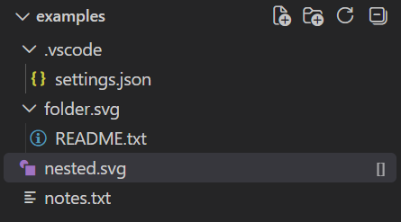
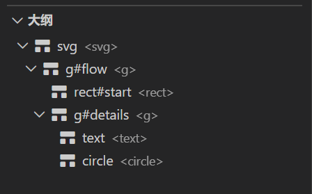
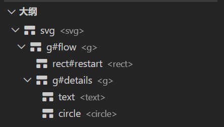
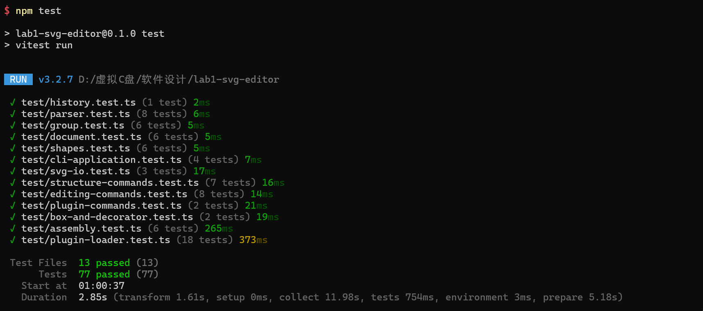
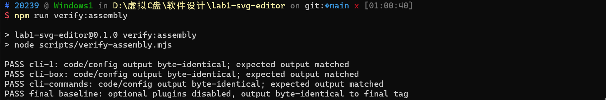

# 26秋 软件设计 lab2 实验报告

24302010001 莫梓铎

## 1. 第一部分：VS Code SVG 扩展

### 1.1 A.1 文件装饰

`SvgFileDecorationProvider` 实现 VS Code 的 `FileDecorationProvider`。它为 `.svg` 文件返回 `[]`，如果遇到目录、普通文件和不存在的 URI 则返回 `undefined`。

入口 `vscode-extension/src/extension.ts` 在 `activate` 中注册 provider，并把返回的 `Disposable` 交给扩展上下文管理。

效果如下

### 1.2 A.2 SVG Outline

`SvgDocumentSymbolProvider` 实现 `DocumentSymbolProvider`。解析器把 SVG 文本转换为轻量元素树，再由适配层转换为 `DocumentSymbol`：

- 有 id 时显示 `tag#id`，无 id 时显示 `tag`；
- `range` 覆盖元素源码范围；
- `selectionRange` 用于点击定位；
- `children` 由子节点递归转换。

解析器支持嵌套分组、无 id 元素、显式闭合标签、注释等功能。编辑文档会触发 provider 重解析并重新渲染。

修改tag从start变为restart之后效果如下

### 1.3 A.3 VS Code、Decorator、Adapter 和复用分析

VS Code 负责扩展生命周期、文档模型、Explorer、Outline、事件分发和显示；插件负责 SVG 判断、文本解析和结果转换。调用链：

~~~text
VS Code -> extension.activate()
        -> registerFileDecorationProvider(...)
        -> registerDocumentSymbolProvider(...)
VS Code -> provideFileDecoration(uri)
VS Code -> provideDocumentSymbols(document, token)
~~~

文件Decorator和经典 Decorator 都采用了“在展示流程中附加信息”的方法。差异在于经典 Decorator 通常包装同接口对象并转发调用，而我这里的 provider 只实现了 VS Code 的独立接口，由 VS Code 反向调用。

我认为元素树到 `DocumentSymbol` 的转换更接近 Adapter：适配层负责内部解析器和VS Code之间的模型转换，解析器不依赖 VS Code 类型。Decorator 解决附加职责，Adapter 解决接口不兼容。

Outline在功能上与阶段一的读写解析器不同，还要兼容不完整XML，因此我没有复用。本次复用的内容包括 id/标签命名约定、树遍历思路和异常输入测试边界。

## 2. 四个扩展点

| 扩展点 | 职责 | 调用位置 | 实现 | 禁用后的行为 |
|---|---|---|---|---|
| `ShapeProvider` | 创建和读回图形 | `ShapeFactory.create()`、`fromElement()` | 阶段一图形 provider、`BoxShapeProvider` | 阶段一支持的六种图形仍可用；box 未装载时return普通分组 |
| `Command` | 命令名、参数、help 和执行 | `CliApplication.executeLine()` | 阶段一命令、`StatsCommandPlugin`、`DirCommandPlugin` | 未加载插件命令时报 unknown command |
| `TreeDecorator` | 给树行追加标签 | 树渲染流程 | `ModifiedStarDecorator`、`BoxTypeDecorator` | 无 decorator 时输出阶段一原始树 |
| `AttributeHandler` | 定义图形属性语义 | `SetAttributeCommand` handler 查询 | box 的 `fill`、`label` | miss时回到阶段一白名单规则 |

接口和注册上下文位于内核侧 `src/plugins/`。内核保存接口引用，不按 `box\)、`stats` 等具体名字增加分支。插件只依赖公开领域抽象和接口，不依赖宿主装配模块。重复注册、未知类型和 manifest 不一致都会产生明确错误。

**验收：** 每个扩展点都有注册、重复注册和缺省行为测试；禁用可选插件后阶段一命令和六种图形仍可启动；无 decorator 时与 `final` 树输出逐字节比较。

## 3. 命令插件：`stats` 与 `dir`

### 3.1 `stats`

`StatsCommandPlugin` 独立于内置命令表，按当前子节点顺序DFS，叶子按首次出现顺序计数；普通 `g` 和 box 只计入 containers，根 SVG 不计入，box 内部叶子照常计数。

### 3.2 `dir` 与 Adapter

`DirCommandPlugin` 依赖 `DirectoryAccess`。`NodeDirectoryAccess` 将 `fs.readdir`/`Dirent` 适配为目录访问接口。

| Adapter 角色 | 项目对象 |
|---|---|
| Target | `DirectoryAccess` |
| Adaptee | Node 文件系统 API |
| Adapter | `NodeDirectoryAccess` |
| Client | `DirCommandPlugin` |

## 4. 属性扩展点契约与事务

`AttributeHandler` 定义“给某类图形设置某属性时的具体修改方式”。执行 `set <id> <attr> <value>` 时，命令先定位图形，再查找 handler；未命中时执行阶段一白名单。box 的 `fill` 修改内部 `<id>-rect`，`label` 修改内部 `<id>-label`。

handler 通过公开领域接口访问对象，不访问注册表内部或私有字段。多个 handler 同时命中时不隐式覆盖：注册阶段按图形类型和属性检查冲突，重复项直接拒绝。

一次 `set` 是一个 undo 单元。命令在执行前保存目标及相关子部件快照，handler 全部成功后才写入历史；redo 使用同一快照。若 handler 部分修改后抛错，则用快照恢复全部对象，且不改变 undo/redo 历史。测试替身专门验证这一点。

## 5. `box` 图形插件

`BoxShapeProvider` 创建：

~~~text
g#n1 data-kind="box"
├── rect#n1-rect
└── text#n1-label
~~~

box 是可嵌套容器，可以整体移动；子部件 id 为 `<id>-rect` 和 `<id>-label`。

## 6. 树标签插件设计

`BoxTypeDecorator` 追加 `(box)`，`ModifiedStarDecorator` 追加 `*`。两个 decorator 独立注册并组合，渲染器不枚举具体标签。

ADR 中：

1. dirty ==“当前序列化内容?=最近保存点”；编辑后出现 `*`，保存或 undo 回到保存点后消失。
2. 子图形变化会使祖先容器也标记 dirty；状态封装在 decorator 实例字段中。
3. 标签按注册顺序拼接；默认顺序为基础描述、`*`、`(box)`，两种装配保持相同顺序。

无标签时树输出与 `final` 一致。

## 7. 两种装配、失败回滚和一致性

方式 A 的 `CodeAssembly` 在组合根中实例化插件；方式 B 的 `PluginLoader` 根据 `plugins.config.json` 解析模块。配置按数组顺序加载，`enabled: false` 跳过，`options` 传入激活过程，manifest 用 `shapes`、`commands`、`decorators`、`attributes` 声明贡献。

两种方式最终都调用 `CliApplication.installExtensions()`，共享注册、冲突校验和原子提交路径。加载器不硬编码具体插件名称、导入映射或条件分支；新增插件只需新增模块和配置。

| 失败 | 输出 |
|---|---|
| 模块找不到 | `error: plugin not found: <module>` |
| 没有默认导出 | `error: plugin has no default export: <module>` |
| manifest 不一致 | `error: plugin manifest mismatch: <name> (declared: …, registered: …)` |
| activate 抛错 | `error: plugin failed to activate: <name> (<reason>)` |

`npm run verify:assembly` 比较基础会话、box 会话、stats/dir 会话的 A/B 输出，并比较禁用新增插件时与 `final` 的输出。

