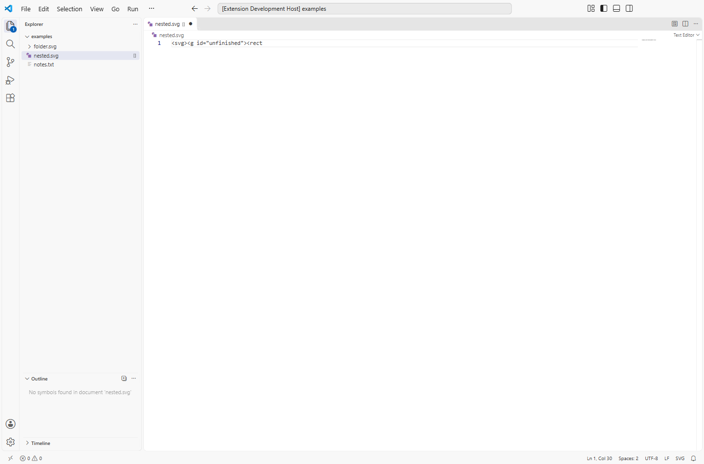

# Lab1 Phase 2 实验报告


姓名：莫梓铎  
学号：24302010001  
仓库：<https://github.com/HioriYo0301/lab1-svg-editor>  


# 第一部分开发记录

## 1. 实验目标与完成范围

本部分从插件开发者角度学习 VS Code 的扩展机制，在已有 SVG CLI 项目中新增独立扩展，完成以下目标：

1. Explorer 中的 SVG 文件显示 `[]` 标记
2. SVG 文本文件在 VS Code 原生 Outline 中显示根元素、容器和叶子的嵌套结构；有 id 时显示 `标签名#id`，无 id 时显示标签名。
3. 点击大纲节点定位对应源码，编辑文本后更新大纲
4. 提供源码、启动步骤、示例文件、验证证据，分析宿主与插件职责、设计模式及阶段一代码复用的可能性。


## 2. 实验环境与阶段划分

### 阶段 1：观察原生大纲并实现扩展

功能节点提交为：

```text
cc45e59 feat: add vscode svg decorations and outline
```

该提交包含扩展源码、依赖锁文件、示例、测试、启动配置、说明文档和运行截图。

## 3. 模块划分与实现方法

扩展位于仓库 `vscode-extension/`，与 CLI 分离。主要文件职责如下：

- `src/extension.ts`：激活入口，注册文件装饰与文档符号 provider，并交由订阅集合管理注册资源。
- `src/svgFileDecorationProvider.ts`：实现 `SvgFileDecorationProvider`，判断 URI 后缀与真实文件类型，返回徽标。
- `src/svgOutlineParser.ts`：实现 `SvgOutlineParser`，生成标签、id、源码范围与子节点构成的结构树。
- `src/svgDocumentSymbolProvider.ts`：实现 `SvgDocumentSymbolProvider`，将解析结果转换为 VS Code 的 `DocumentSymbol`。
- `examples/`：包含嵌套 SVG、普通文本及名为 `folder.svg` 的目录，验证正常和边界行为。
- `test/`、`scripts/`：单元测试与真实扩展宿主测试。

### 3.1 SVG 文件标记

`SvgFileDecorationProvider` 实现宿主定义的 `FileDecorationProvider` 接口。查询时先确认 URI 是本地文件 URI、后缀为 `.svg`，再调用 `workspace.fs.stat` 排除目录；读取失败或 URI 不适用时返回无装饰。

对符合条件的文件返回 `badge: "[]"`，并关闭向父目录传播。扩展没有重命名文件或写入文件内容的操作。启动完成事件使其在未打开 SVG 文本时也可提供 Explorer 标记。

### 3.2 SVG 大纲与源码定位

解析层采用 SAX 严格 XML 结构解析，记录每个元素的标签名、可选 id、起始偏移、起始标签结束偏移、整个元素结束偏移和子节点。源码偏移采用 UTF-16 单位，与 VS Code 的 `positionAt` 一致，避免中文和 emoji 导致定位偏差。

符号适配层将这些偏移转换为 `Range` 与 `selectionRange`，将子元素转换为 `children`。显示名称有 id 时为 `tag#id`，否则为标签名。VS Code 使用返回的符号树显示原生 Outline，并在选择节点时定位起始标签。

本实现处理 XML 的显式结束标签和自闭合标签，不按 `rect`、`circle` 等 SVG 图形名字推断标签是否闭合。注释与 CDATA 中的伪标签不会变为大纲元素。

### 3.3 编辑刷新与异常恢复

宿主在文档变化后重新请求符号，provider 每次读取最新文本，不依赖保存文件。不完整或非法 XML 返回空符号集合，不把部分错误结构交给宿主。输入恢复合法后，下次请求即可重建大纲。


## 4. 宿主与插件职责、注册与调用关系

VS Code 负责 Explorer、Outline、文档与编辑器、文件系统接口、文档变化后的符号请求，以及符号选择后的源码定位。扩展负责 SVG 相关的判定、解析和适配，不接管宿主界面的生命周期。

调用过程为：VS Code 根据扩展清单加载入口并调用 `activate(context)`；入口注册两个 provider；宿主按需调用装饰查询或 `provideDocumentSymbols(document)`；provider 返回装饰对象或符号对象；宿主完成界面显示。注册返回的可释放资源放入 `context.subscriptions`，由 VS Code 在扩展释放时处理。

依赖方向为：

```text
VS Code 宿主 → provider 接口 → 扩展 provider 实例
SvgDocumentSymbolProvider → SvgOutlineParser
SvgDocumentSymbolProvider → VS Code Range / DocumentSymbol
```

插件被宿主回调，同时通过公开 API 使用宿主能力；它不依赖 VS Code 的内部实现，也不导入阶段一 CLI 的入口或历史管理模块。

## 5. 设计模式分析

### 5.1 文件装饰与经典 Decorator

两者均能在保留已有对象身份和主要功能的基础上增加表现。本实验给文件附加 `[]`，没有改变文件名或内容，具有装饰效果。

但经典 Decorator 通常实现与被包装对象相同的 Component 接口，持有 Component 引用，并在调用转发前后增加行为。本实现是 provider 回调：VS Code 持有注册的 provider，查询时取得 `FileDecoration`，再组合显示；provider 没有包装文件对象，也没有转发文件读写接口。因此不能仅因 API 名为 Decoration 就认定实现了完整的经典 Decorator 结构。

### 5.2 Adapter / adaptor 的对应关系

文件装饰中，宿主是客户，`FileDecorationProvider` 是目标接口，`SvgFileDecorationProvider` 将 URI、文件类型与 SVG 判断规则转换为宿主需要的 `FileDecoration`。它具有接口适配作用，但被适配的是信息与规则，而不是一个现成的旧装饰类。

更明确的对象适配发生在大纲：`SvgOutlineParser` 提供与编辑器无关的节点树，`SvgDocumentSymbolProvider` 通过对象组合使用它，将解析节点适配为宿主需要的 `DocumentSymbol`、`Range` 和 `selectionRange`。XML 解析层无需知道 Outline 如何渲染，宿主也无需了解 SAX 内部回调。


## 7. 分阶段验收方法与结果

### 7.1 准备与启动

在仓库根目录的终端执行：

```powershell
cd vscode-extension
npm install
npm run typecheck
npm test
npm run compile
```

在 VS Code 打开仓库根目录，进入运行和调试面板，选择 `SVG Lab: Extension Development Host`，按 F5。配置会编译扩展，打开标题含 Extension Development Host 的新窗口及示例工作区。在新窗口打开 `nested.svg`。

若显示图片而不是源码，右键文件选择 Open With → Text Editor。示例工作区已有 `.svg` 文本编辑器关联，不修改用户全局关联。展开 Explorer 下方 Outline；必要时通过命令面板查找 Outline 并聚焦该视图。

### 7.2 A.1 文件标记验收

同时观察 `nested.svg`、`notes.txt` 和 `folder.svg` 目录。预期只有 SVG 文件显示 `[]`；其文件名仍为 `nested.svg`。自动验收另外覆盖不可访问文件和非本地文件 URI。


> **截图预留 P1-02：文件标记。**  
> 内容：Explorer 同时显示 `nested.svg []`、无标记的 `notes.txt` 以及无标记的 `folder.svg` 目录。  
> 获取方式：在 F5 新窗口打开示例工作区，展开资源管理器，使用 `Win + Shift + S`；建议保存为与本报告同级的 `p1-02-svg-badge.png`。也可直接复用下面已有的真实宿主自动验收截图。

<!-- 截图占位 P1-02 -->

已有自动验收截图（同时覆盖文件标记、大纲层级和定位）：


### 7.3 A.2 层级、无 id 与点击定位验收

打开 `nested.svg`，依次展开大纲中的 `svg`、`g#flow`、`g#details`，确认 `rect#start`、无 id 的 `text` 与 `circle` 位于正确层级。点击 `rect#start`，预期编辑器定位到第 4 行起始标签，而不是跳到图片预览。

**结果：真实 Outline 点击测试通过，第 4 行定位正确。**

> **截图预留 P1-03：大纲层级与源码定位。**  
> 内容：左侧完整大纲（含无 id 的 text、circle），右侧对应源码及行号，选中 `rect#start` 并显示光标定位第 4 行。  
> 获取方式：拖高 Outline 面板并展开全部容器，点击节点后截图；建议保存为与本报告同级的 `p1-03-outline-location.png`。可复用上一节已有 `01_badge_outline_location.png`，无需重复插入。

<!-- 截图占位 P1-03 -->

### 7.4 编辑更新验收

将源码的 `id="start"` 改成 `id="updated"`，暂不保存。预期 Outline 更新为 `rect#updated`。本实验只读扩展信息，修改来自测试者的编辑操作。

**结果：真实宿主测试通过，未保存修改也触发更新。**

> **截图预留 P1-04：编辑后的大纲更新。**  
> 内容：源码显示 `id="updated"`，大纲显示 `rect#updated`，编辑器标签页显示未保存标志。  
> 获取方式：在前一步基础上修改 id，等待大纲刷新后截图；建议保存为与本报告同级的 `p1-04-outline-update.png`。也可复用下面已有的自动验收截图。截图后撤销修改，不必保存。

<!-- 截图占位 P1-04 -->


### 7.5 不完整 XML 与恢复验收

临时将文档改为 `<svg><g id="unfinished"><rect`。预期大纲清空、编辑器继续可用、扩展没有未处理异常。随后撤销编辑恢复完整 XML，确认大纲重新出现。

**结果：真实宿主测试通过；恢复后再次得到原符号树。**

> **截图预留 P1-05：异常输入及恢复。**  
> 内容：一张显示不完整 XML 与大纲无符号的截图，必要时再补一张恢复后的完整大纲。  
> 获取方式：关闭自动保存后临时替换文本，截图，再 Ctrl+Z 恢复；建议保存为与本报告同级的 `p1-05-incomplete-xml.png` 与 `p1-05-recovered.png`。已有异常截图如下。不要将故意损坏的示例提交到 Git。

<!-- 截图占位 P1-05 -->



### 7.6 自动化验证与阶段一回归

在扩展目录执行 `npm run test:host`，脚本通过微软测试运行器启动独立 VS Code，在临时工作区和隔离配置内加载本扩展。测试断言与界面操作是本项目编写的，不是老师提供的官方评分程序；通过表示满足当前测试覆盖的场景，仍需结合题目和实际界面检查。

测试包括：文件装饰适用范围、注册 provider 返回的层级、真实 Outline 点击、编辑更新、不完整输入与恢复，以及磁盘文件字节和目录名称不变。Playwright 操作真实宿主界面并保存三张截图。首次运行需要下载独立编辑器，后续复用缓存；调试端口 9337 需空闲。

已记录结果：

- 扩展 typecheck 与 compile 通过。
- 解析单元测试 12 项通过，覆盖嵌套、无 id、显式闭合、CRLF/中文/emoji 源码范围、注释、CDATA、引号内分隔符、非法 XML 与编辑更新。
- 真实 VS Code 1.148.0 宿主六组检查通过，日志为与本报告同级的 [host-results.txt](host-results.txt)。
- 仓库根目录 `npm run typecheck`、`npm test` 通过，阶段一 49 项测试保持通过。
- `git diff --check` 通过。

> **截图预留 P1-06：自动检查结果。**  
> 内容：扩展 12 项测试通过、宿主六条 PASS 与 Exit code 0；可另补 CLI 49 项回归结果。  
> 获取方式：在相应目录运行上述命令，终端输出结束后截图，保存为与本报告同级的 `p1-06-tests.png`；输出过长可分两张，不截取失败结果冒充成功结果。运行真实宿主测试会更新同级的自动验收图片，提交前应检查这些变化。

<!-- 截图占位 P1-06 -->

## 8. AI 协作中的检查与修正

本次使用 AI 辅助生成实现、测试和文档，并通过类型检查、边界用例和真实宿主复验纠正以下问题：

1. 初版仅根据文件名后缀装饰，会误标 `folder.svg` 目录。加入真实文件类型检查后通过目录反例。
2. 初版正则解析按 SVG 图形名字推断空元素，显式 `<rect></rect>` 可能破坏父栈。改用 SAX 结构解析，补充显式闭合、注释、CDATA、引号等测试。
3. 初版调用 DocumentSymbol 构造器时传入额外 children 参数，类型检查报错。按公开类型签名构造，再通过 children 集合加入子符号。
4. 初版构建同时编译测试，导致 Vitest 重复扫描 CommonJS 产物。构建范围限定 src，CLI 与扩展分别限定测试范围。
5. 真实界面发现默认图片预览关联会影响 Outline 点击。示例工作区显式关联文本编辑器，并说明宿主与文本文件前提。
6. 本机 VS Code 更新锁阻止启动时，改用独立测试编辑器完成验收，没有修改本机安装或用户配置。

上述检查说明：AI 生成的实现与测试需要结合题意、类型定义和真实运行结果复核，不能仅凭生成完成判断实验通过。
