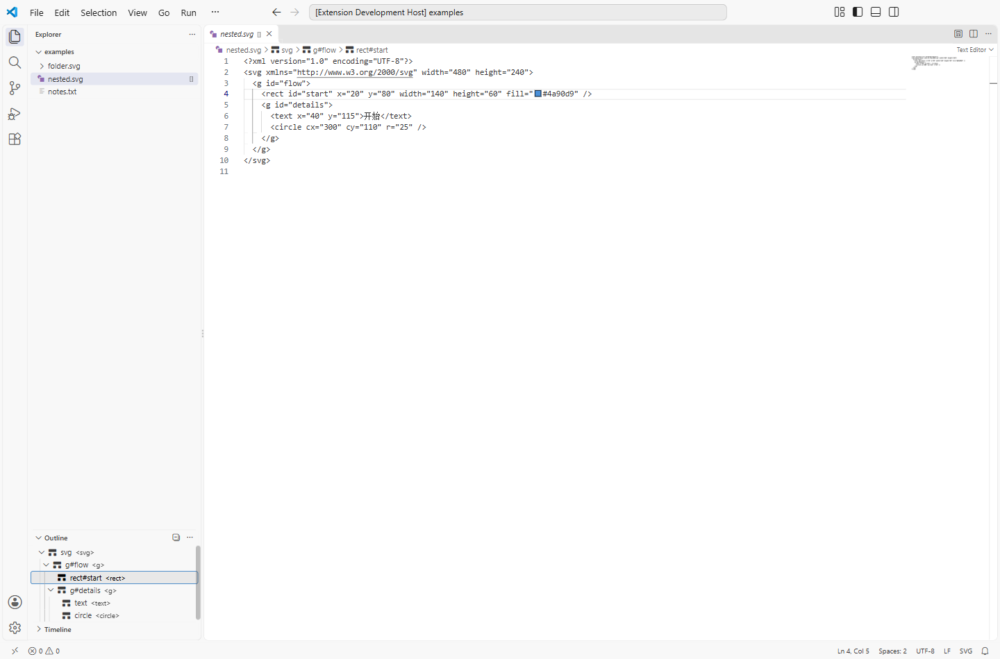
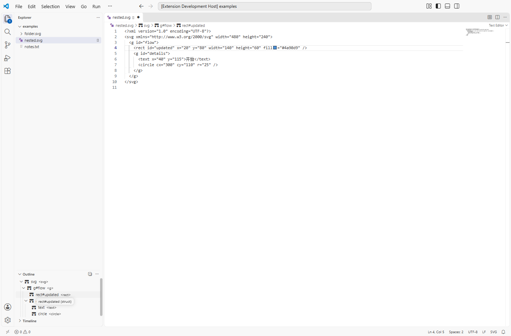
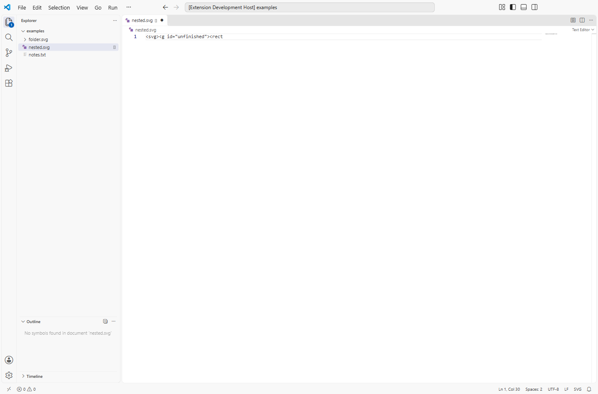

# SVG Lab Tools

这是阶段二 A 部分的 VS Code 扩展实践。它提供两项只读的编辑器界面能力：Explorer 中 `.svg` 文件显示 `[]`，以及 SVG 文本文件的原生 Outline。

## 安装和启动

```powershell
cd vscode-extension
npm install
npm run typecheck
npm test
npm run compile
```

在 VS Code 中打开**仓库根目录** `lab1-svg-editor`，选择运行配置 `SVG Lab: Extension Development Host` 后按 `F5`。配置会先编译扩展，再启动 Extension Development Host 并打开示例工作区。在新窗口打开 `nested.svg`，展开 Outline（大纲）视图。启动前需在扩展目录完成 `npm install`。

也可在仓库根运行：

```powershell
code --new-window --extensionDevelopmentPath="$PWD/vscode-extension" "$PWD/vscode-extension/examples"
```

不需要发布到扩展市场或配置 API 密钥。入口为 `out/extension.js`；源码与锁文件提交，`out/`、`node_modules/` 和测试编辑器缓存不提交。

本题要求打开 **SVG 文本文件**。示例工作区附带设置让 `.svg` 使用文本编辑器。在自己的工作区如果打开的是图片预览，请右键 SVG → Open With / 打开方式 → Text Editor / 文本编辑器，并配置为 SVG 的默认编辑器，否则点击大纲时宿主可能按默认文件关联切回图片预览。扩展不修改用户的全局编辑器关联。

扩展只读取文档内容并返回 VS Code 的界面对象，不修改文件名或文件内容。文件装饰读取 URI 的文件类型，排除普通目录和名称以 `.svg` 结尾的目录；不可访问的 URI 不装饰。启动完成事件使扩展在没有打开 SVG 时也能提供标记。Outline 对 SVG 语言文档或 `.svg` 文件生效，每次根据最新文本生成结果；XML 不完整或不合法时清空大纲，恢复合法 XML 后重新显示。

## 职责与模式分析

VS Code 负责文件系统、Explorer、Outline、编辑器和文档变更通知；扩展负责判断哪些 URI 应显示装饰、解析 SVG 元素并转换为 `DocumentSymbol`。扩展通过 `activate` 注册两个 provider，VS Code 在需要渲染装饰或大纲时调用它们。

文件装饰具有 Decorator 的效果：它给文件附加显示信息，但不改变文件本身。它不像经典 Decorator 那样包装并转发同一业务接口：`SvgFileDecorationProvider` 实现宿主接口，VS Code 组合并调用它，扩展不持有或替换文件对象，也没有 `ConcreteDecorator → Component` 的业务调用链。因此这里是装饰能力和对象组合，而不是完整照搬经典 Decorator 的类结构。

从 Adapter（题目中的 adaptor）角度看，宿主的 `FileDecorationProvider` 是目标接口，`SvgFileDecorationProvider` 把 URI/文件类型判断适配为 `FileDecoration`，VS Code 是客户。这里被适配的是文件信息和显示规则，不是一个具有相同功能的旧装饰对象，不应把 API 名称直接等同于经典模式。更清晰的对象适配关系在 Outline：`SvgDocumentSymbolProvider` 组合 `SvgOutlineParser`，把包含 UTF-16 位置的 SVG 节点转换为 VS Code `DocumentSymbol`，宿主再负责渲染、刷新和定位。

阶段一复用评估：

- `SvgReader` 使用 fast-xml-parser，按六种支持图形创建对象、补 id、检查几何参数，缺乏源码范围；直接复用会拒绝 CLI 不支持的 SVG 元素，也会自动补 id，与大纲需求不同，因此不直接复用。
- `Shape`/`Group` 表达可编辑几何行为，不保留 XML 范围且要求 id。Outline 只需要读取文本，直接复用会增加无关依赖和校验，因此不复用领域对象。
- 复用 Group 的递归遍历思想；其 Iterator 返回领域 Shape，所以本实现对 XML 树递归生成符号，不导入 CLI、History 或 Commands。
- 独立 SAX 层保留源码偏移、完整嵌套、显式/自闭合标签、注释、CDATA 和带引号的 `>`。只做结构解析，不做完整 SVG 规范验证，不解析外部实体。

## 自动测试与真实宿主测试

```powershell
npm run typecheck
npm test
npm run compile
npm run test:host
```

`test:host` 使用微软 `@vscode/test-electron` 下载独立编辑器，在临时工作区和独立用户配置中运行，不修改你的 VS Code 设置。首次下载较大，后续使用缓存。也可设置环境变量 `VSCODE_EXECUTABLE_PATH` 指定本机 Code.exe。真实宿主使用调试端口 9337，运行时该端口需空闲。

单元测试覆盖嵌套/无 id、显式闭合、源码范围（含 CRLF/中文/emoji）、注释/CDATA/属性引号、编辑更新和非法 XML。主机测试调用真实 VS Code 注册接口，再通过真实 Outline 点击验证定位、编辑刷新、非法输入恢复，检查磁盘字节和文件名不变，并保存截图到 `doc/evidence/vscode/`。

参考：[VS Code API](https://code.visualstudio.com/api/references/vscode-api)、[微软扩展测试指南](https://code.visualstudio.com/api/working-with-extensions/testing-extension)。

## AI 建议的检查与修正

- 初版正则扫描器把 rect 等标签当作 XML 空元素，导致 `<rect></rect>` 影响父栈；改用 SAX，不再按图形名字推断闭合。
- 初版只看 URI 后缀，误标 `folder.svg/` 目录；改用宿主文件类型判断。
- 初版将测试编译到 `out/test`，导致重复执行 CommonJS 产物；构建限定 src，根 CLI 与扩展各自限定测试范围。
- 核对真实类型定义后修正 DocumentSymbol 构造参数，通过 children 添加子符号，并确保入口与清单一致。
- 真实主机测试发现图片预览关联会影响大纲跳转，因此示例工作区显式使用文本编辑器，测试也在隔离配置中验证这一前提。

## 手工验收

- `nested.svg` 在 Explorer 中显示 `[]`，普通文件和目录没有该标记。
- Outline 显示 `svg`、`g#flow`、`rect#start`、`g#details`、`text` 和 `circle` 的层级。
- 点击节点定位到对应起始标签。
- 编辑 id 或嵌套关系后 Outline 更新。
- 删除结束标签制造不完整 XML，扩展仍保持可用。

## 本次真实运行证据（2026-11-25）

独立 VS Code 1.148.0 Extension Development Host 已通过六组检查，原始结果见 [host-results.txt](../doc/evidence/vscode/host-results.txt)。代码在真实宿主中运行；截图不是模拟界面。

1. 文件标记与原生大纲定位：`nested.svg` 右侧显示 `[]`，`notes.txt` 与 `folder.svg` 目录无标记；大纲选中 `rect#start` 后定位第 4 行。



2. 在编辑器内将 id 改为 updated（未保存），大纲和面包屑同步变化。



3. 输入不完整 XML 后大纲显示无符号；测试随后恢复完整内容并验证大纲恢复。整个测试未保存临时修改，磁盘字节和文件名检查通过。



宿主观察：Outline 是 VS Code 已有的树视图，支持折叠容器、单击选择符号并定位文本；符号来自 provider 返回的 `children` 与 `selectionRange`，扩展不另造 TreeView。编辑器文档变化后宿主重新请求符号，无符号时显示原生空状态。SVG 默认图片关联会影响点击跳转，已通过示例工作区的文本编辑器关联解决。
